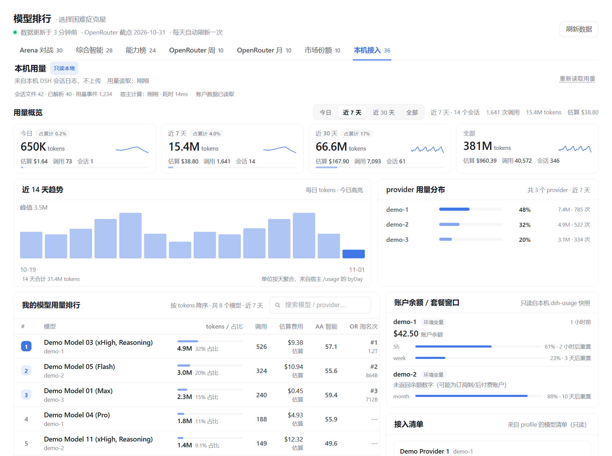
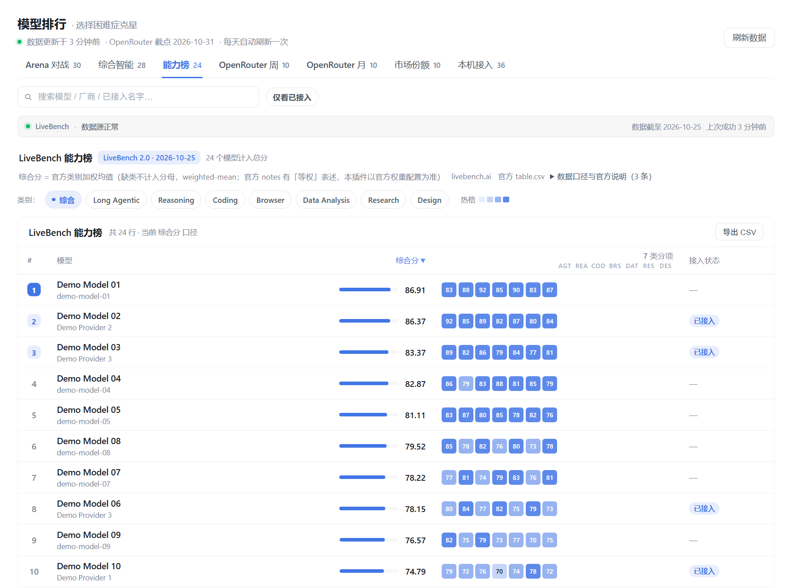
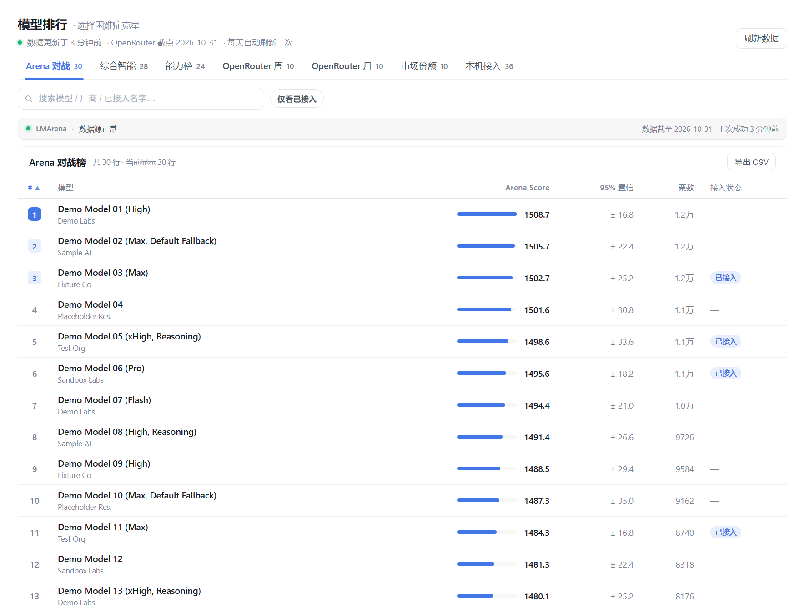

<p align="center">
  <strong>English</strong> · <a href="README.md">简体中文</a>
</p>

<p align="center">
  
</p>

<h1 align="center">dsh-model-rank</h1>

<p align="center">
  <strong>You have a dozen models wired up. Which one should you actually use?</strong><br>
  A sidebar plugin for <strong>DeepSeek Harness (DSH)</strong>: it adds a "Model Rank" entry to the DSH
  sidebar. Open it to compare mainstream LLMs by human blind-test ratings, an intelligence index,
  task-level capability, real-world usage and price/speed — and to see which models your machine is
  connected to and how much you actually use them. Too many providers, too many models, and picking
  one means opening several websites first? That is exactly what this plugin is for
  (works in the DSH desktop app and with <code>dsh web</code>).
</p>

<p align="center">
  <a href="https://github.com/Jingxuan-WH/dsh-model-rank/releases/latest"></a>
  <a href="https://github.com/Jingxuan-WH/dsh-model-rank/actions/workflows/ci.yml"></a>
  
  <a href="https://github.com/Jingxuan-WH/dsh-model-rank/stargazers"></a>
  <a href="https://github.com/Jingxuan-WH/dsh-model-rank/commits/main"></a>
  <a href="LICENSE"></a>
</p>

## In 30 seconds

- **One panel, seven tabs**: Arena, Intelligence, Capability (LiveBench 2.0), OpenRouter weekly,
  OpenRouter monthly, Market share, and 本机接入 — six public boards plus a local usage page
  (the dashboard inside the 本机接入 tab). Different measurements stay separate; there is deliberately
  no made-up "overall score".
- **Your models are tagged**: the plugin reads your local model list from `cordis.patch.yml`
  (read-only) and marks the rows you can actually use on every board.
- **Opens instantly**: the host fetches public leaderboards once a day and caches a snapshot; the
  panel renders from browser cache first. The browser makes no external requests.
- **Compare and dig in**: click a model row to open a detail drawer; every board can be sorted and
  exported (the currently filtered rows) as CSV.
- No configuration, no API keys.

**It is for you if** you juggle several providers, relays or official endpoints; picking a model
means opening several websites first; or you want to know how the hot new #1 compares with what you
actually run, and where your tokens go.

## Screenshots

<p align="center">
  
  <br>
  <sub><b>Capability board (LiveBench 2.0)</b>: long-horizon / agentic capability, official weighted overall score + 7 categories; click a row for details, export as CSV</sub>
</p>

<p align="center">
  
  <br>
  <sub><b>Leaderboard</b>: LMArena human-preference ratings with local-connection tags; search, filter, row details, CSV export</sub>
</p>

## What it does

### 1) Six public boards: one model, six angles

| Tab | What you see | Source | Refresh |
|---|---|---|---|
| **Arena** | LMArena text leaderboard: human blind-test Bradley-Terry ratings with confidence interval and vote count | LMArena's official Hugging Face dataset | On official release |
| **Intelligence** | Artificial Analysis Intelligence Index (0–100) plus price, speed, context and open-weight flag | artificialanalysis.ai (**fetched at runtime on your machine only**) | Daily |
| **Capability** | LiveBench 2.0 long-horizon / agentic capability: official **weighted overall score** + categories (Long Agentic / Reasoning / Coding / Browser / Data Analysis / Research / Design; the current release has 7, and this can change between releases) | livebench.ai official public CSV (**fetched at runtime on your machine only**) | With each official release; the plugin checks every 24 hours |
| **OpenRouter weekly** | Real developer token usage over the last week | openrouter.ai/rankings page tables | Daily |
| **OpenRouter monthly** | Real token usage over the last 30 days | same | Daily |
| **Market share** | Provider request share (weekly) | same | Daily |

> These boards are **not comparable with each other**: human preference ≠ intelligence index ≠
> task-level capability benchmark ≠ real token usage. Each tab states its own basis and source, and
> the plugin never merges them into a fake total score.
>
> The Intelligence and Capability data are **fetched at runtime on your machine only** and are not
> bundled with the package. On a fresh install those two tabs may be empty until the host completes
> its first online refresh.

### 2) 本机接入: what you have, what you use

- **Connected tags** (all boards): model lists are read from
  `<DSH_HOME>/profiles/*/cordis.patch.yml`, normalized and matched to leaderboard rows. A
  "connected only" toggle filters every board to what you can actually run.
- **Local usage dashboard**:
  - **KPI cards**: tokens, **estimated** cost and call count for today / last 7 days / last 30 days / all time;
  - **range switcher**: today / last 7 days / last 30 days / all time (local data only);
  - **per-model usage ranking** with share bars, plus the intelligence index and OpenRouter weekly
    position when a match exists;
  - **provider split + 14-day token trend**;
  - **provider cards**: one card per configured provider, with its models and their positions;
  - **account balance / plan windows**: shown when a local `dsh-usage` snapshot exists (read-only,
    optional; hidden otherwise).
- **Basis**: the aggregation covers **every session log the host can read** — including sessions that
  predate plugin installation; cleaning old logs reduces the totals (deleted data is not backfilled).
  Days are local days in **Asia/Shanghai (UTC+8)**; "today" is the current local day and "last 7 / 30
  days" include today.
- **Cost**: estimated from **Artificial Analysis published USD prices** × local token usage. The panel
  shows the **pricing coverage** (share of tokens that could be priced); models without a matched
  public price show `—` (never 0), and no cost estimate appears until the first successful runtime
  fetch. It is an estimate, not your invoice.
- Everything comes from a read-only scan of local session logs — no upload, no network.

### 3) Shared interactions: sorting / detail drawer / CSV export / source status

- **Sorting**: click a column header to sort any board ascending or descending.
- **Detail drawer**: click a model row in **Arena / Intelligence / Capability** to open a side panel
  with that board's breakdown, price/speed, capability categories and your own usage (when available).
- **CSV export**: export the current board's **currently filtered** rows as a CSV file, generated
  locally in the browser with a UTF-8 BOM (so Excel opens Chinese text correctly). Nothing goes
  through a server.
- **Source status**: each board header shows its source, the board version / last sync time, and a
  stale hint when the source failed.

### 4) Instant open: snapshot plus cache

- After a successful fetch the host waits 24 hours before fetching again; failures retry after
  2 hours. The "Refresh" button is throttled to once per 10 minutes.
- On load the panel renders from browser cache first, then reconciles with the host snapshot — so it
  never waits on the network to show something.
- If a source fails, the previous snapshot is kept and marked stale. No fake data, no zeroed tables.

### 5) Visual refresh (v0.2.0)

Calmer ranking visuals, sticky table headers, card layout on narrow screens, and full support for
the DSH light/dark themes. The detail drawer ships with this refresh.

## Install

**Requires**:

- **DSH 0.2.x** (verified on **0.2.1-rc.5**).
- A host runtime with **Node.js ≥ 22.15** (for `node:zlib` zstd decoding, used to read compressed
  session logs; older versions skip `.zstd` logs with a warning and count uncompressed logs normally).
  The runtime bundled with DSH usually satisfies this.

There is no build step; restart DSH once after installing.

### Desktop app (recommended, ~30 seconds)

1. Open the DSH desktop app → **Settings → Plugins**;
2. Choose **Add plugin** and paste the repository URL:

   ```
   https://github.com/Jingxuan-WH/dsh-model-rank
   ```

3. Restart DSH when prompted (the host composes plugins at startup);
4. A **Model Rank** entry appears in the left sidebar.

### `dsh web`

```bash
dsh plugin --profile web add https://github.com/Jingxuan-WH/dsh-model-rank
```

Restart `dsh web` afterwards, then reload the page.

> Use your own profile name instead of `web` if it differs. The desktop app manages its own profile —
> install through its plugin page rather than the CLI.

### 30-second check

1. **Look at the sidebar**: after the restart, a "Model Rank" icon is there;
2. **Open it**: the panel header shows "data updated at …" and seven tabs (Arena / Intelligence /
   Capability / OpenRouter weekly / OpenRouter monthly / Market share / 本机接入);
3. **Open the 本机接入 tab**: KPI cards, the usage ranking and your provider list are there.
   On a brand-new install it may show the bundled snapshot and explain the counting start; the
   Intelligence and Capability tabs appear after the host's first online refresh.

If all three are true, both the host half and the client panel are working.

### Upgrade / uninstall

- **Upgrade**: run the install command again (it pulls the latest main), then restart DSH.
  In the desktop app, update through the plugin page.
- **Uninstall**: remove it from the plugin page, or:

  ```bash
  dsh plugin --profile web remove dsh-model-rank
  ```

  Uninstalling keeps your local cache (see Privacy); delete the directory manually if you want a
  clean slate.

## FAQ

**The sidebar entry does not appear.**
Restart DSH, then reload the page. On desktop, install through the app's plugin page (the app owns
its profile); on the web CLI, make sure you installed into the profile you actually run.

**Why are the Intelligence and Capability tabs empty the first time?**
Both are fetched at runtime on your machine and are not bundled (compliance reasons). They appear
after the host's first successful online refresh; the other boards work immediately from the bundled
snapshot or browser cache.

**How often does the data update? Why did "Refresh" change nothing?**
The host does not refetch within 24 hours of a success (2-hour retry after a failure), and manual
refresh is throttled to once per 10 minutes. Each board's source-status line shows its version and
last sync time.

**How is the Capability (LiveBench 2.0) overall score computed?**
It is the **weighted mean** of the categories that have a score, using the official
`_overall_weights` from the public `categories.json`: Long Agentic 2.0, Coding 1.5, Design 1.5 and
1.0 for the rest. Categories without a score are left out of the denominator. The current release
has 7 categories, and that can change between releases. Models are tested at their **highest
supported effort** setting. Scores are official public data; the plugin only displays them.

> For transparency: the official `notes.json` contains a line saying "Overall is the mean of the
> suites … Every suite counts equally" (equal weighting), which **contradicts** the weights in
> `categories.json`. This plugin follows the **weight configuration** and labels the formula in the
> panel — the contradiction is in the official data itself; if LiveBench later unifies the definition,
> the plugin will follow the data.

**Can I compare scores across boards?**
No. Arena is human preference, Intelligence is a third-party capability index, Capability is a
task-level benchmark, and OpenRouter is real token usage. They come from different measurement
systems (six public board views from four public data sources), so the panel keeps them separate and
never ranks across boards.

**When does local usage start counting?**
The aggregation covers every session log the host can read — including sessions that predate plugin
installation. Days are Asia/Shanghai local days; cleaning old logs reduces the totals (deleted data is
not backfilled).

**How accurate is the cost figure? Why do some models show "—"?**
It is an estimate based on Artificial Analysis published prices, for reference only. Only tokens
matched to a public price are priced, and the panel shows the pricing coverage. Private gateway
models without a public price show "—" instead of 0.

**What does CSV export include? Will Chinese text break?**
The current tab's **currently filtered** table (with headers), generated and downloaded locally in
your browser. The file carries a UTF-8 BOM, so Excel opens Chinese text correctly.

**How do I open the detail drawer?**
Click a model row in Arena / Intelligence / Capability. The drawer shows that model's breakdown,
price/speed and your own usage (when available).

**Why is my model not tagged as "connected"?**
Matching relies on normalized names; some provider-specific aliases will not match (expected).
Open an issue with the model name if you want it handled.

**Does it read my conversations or upload anything?**
It never uploads. The plugin only reads local config and usage events (read-only); aggregates and
CSV exports stay on your machine, and the browser half makes no external requests. See Privacy.

**Do I need an API key? Does it cost anything?**
No. It fetches public leaderboard pages only — no account, no API key, and the plugin never calls a
model.

**Which DSH versions are supported?**
0.2.x (verified on 0.2.1-rc.5). Older versions may lack the required slots.

**Is the interface available in English?**
The panel UI is currently Chinese (it follows the DSH UI language). An English UI is on the roadmap.

## Data sources and attribution

The panel has **7 tabs**: **6 public board views** (Arena / Intelligence / Capability / OpenRouter
weekly / OpenRouter monthly / Market share) from **4 independent public data sources** (LMArena /
Artificial Analysis / LiveBench / OpenRouter), plus **1 local view** (the 本机接入 tab) whose data comes
from your own machine. Counting the local source, that makes **5 data sources** — they come from
**different measurement systems** and are **not comparable**; the plugin never merges them into a
"total score". Every tab states its own basis, and the "Source" column lists the public pages the
host actually fetches.

| View (panel tab) | Basis in one line | Source | Refresh cadence | License / attribution |
|---|---|---|---|---|
| **Arena** | Bradley-Terry preference ratings from human blind tests (with confidence interval and vote counts) | LMArena's official Hugging Face dataset [`lmarena-ai/leaderboard-dataset`](https://huggingface.co/datasets/lmarena-ai/leaderboard-dataset) (read through the public Hugging Face datasets-server endpoint) | With LMArena's official releases (typically every 1–few days); the plugin checks every 24 hours | **CC BY 4.0** (dataset license) |
| **Intelligence** | Artificial Analysis Intelligence Index (0–100) plus price / speed / context / open-weight flag | [artificialanalysis.ai/models](https://artificialanalysis.ai/models) | With AA's site; fetched **at runtime on your machine** every 24 hours | **Runtime-only; not redistributed** with the repo or package; rights belong to Artificial Analysis |
| **Capability** (LiveBench 2.0) | LiveBench 2.0 long-horizon benchmark: official **weighted mean** of the current release's capability suites (weights from the official categories JSON; missing suites are left out of the denominator; 7 categories in the current release, and this can change between releases); the panel shows the current release | [livebench.ai](https://livebench.ai/) (official public CSVs: `/data/<release>/table.csv` and `categories.json`) | With LiveBench releases; the plugin checks every 24 hours | **Runtime-only; not redistributed**; LiveBench is an independent open-source project (code Apache-2.0); data rights belong to LiveBench |
| **OpenRouter weekly / monthly / market share** | Real token usage over the last 7 / 30 days and provider request share, from OpenRouter's public page tables | [openrouter.ai/rankings](https://openrouter.ai/rankings) | With the page (it shows its data-through date); the plugin fetches every 24 hours | **CC BY 4.0** (per the source site) |
| **本机接入** | Your machine's token usage, estimated spend and configured inventory, aggregated locally (read-only, never uploaded) | Your own machine: `<DSH_HOME>/profiles/*/cordis.patch.yml`, `<DSH_HOME>/sessions/**/session*.jsonl(.zstd)`, and optionally `<DSH_HOME>/dsh-usage/provider-snapshots.json` | Read on every refresh; silently every 60 s while the panel is visible (local data only) | Your data; read-only, never uploaded |

> "Data updated at" in the panel is the snapshot's fetch time. Each source's own "data through"
> date is authoritative on the source page; fetch cadence is not data freshness.

**Why these numbers are not comparable**

- There is **no conversion** between them: an Arena rating around 1500, an AA index of 42, a
  LiveBench overall of 85.7 and "1.2T tokens" on OpenRouter have different units, samples and
  purposes (illustrative values, not a specific model).
- The panel **never computes a total score, never sorts across boards and never combines them**.
- Different windows of the same source (OpenRouter weekly / monthly / share) are independent too.
- The Capability tab shows **the current LiveBench release only**; models and scores from different
  releases are not mixed.
- "Estimated cost" is an estimate, not your invoice (see "Local usage basis" below).

**Distribution and affiliation**

- The bundled fallback snapshot shipped with the repo/package contains **LMArena and OpenRouter data
  only**. Artificial Analysis and LiveBench data are fetched at runtime on your machine and cached
  locally — **never redistributed** with the repo or package. (The 0.1.0 bundled snapshot still
  contained AA data; 0.2.0 removes it — see CHANGELOG.)
- The Capability board appears only after the host's **first successful online refresh** (the bundled
  snapshot does not contain it); when offline, the last successful data is kept and marked stale.
- This project is **not affiliated with** LMArena, Artificial Analysis, LiveBench or OpenRouter. Data
  rights belong to their respective sources, as stated on the source pages; the plugin only
  aggregates and displays.
- Code is licensed under [LICENSE](LICENSE) (MIT) — **code licensing and data licensing are separate
  matters**.

**Local usage basis**

- **What is read**: only the local paths listed above (DSH config + session logs). No chat content is
  read, nothing is uploaded, and the browser half makes no external requests. See "Privacy".
- **Token buckets**: uncached input, cache reads, cache writes and output are counted separately;
  `total tokens = the sum of the four`. For the same turn/step, the provisional usage event and the
  final one are counted once (the final event wins); "calls" = deduplicated usage events.
- **Cost (estimate)**: estimated from **Artificial Analysis published USD prices** (USD per 1M tokens)
  multiplied by local token usage. It is labelled "estimated" and is **not your invoice**. Only models
  with a matched public price are priced; unpriced models show `—` (never 0). The panel shows the
  **pricing coverage** (share of tokens that could be priced). The bundled snapshot excludes AA data,
  so **no cost estimate appears until the first successful runtime fetch**.
- **Time zone**: local days in **Asia/Shanghai (UTC+8)**; "today" is the current local day, and
  "last 7 / 30 days" include today.
- **Counting start**: the aggregation covers **every session log the host can read** — including
  sessions that predate plugin installation; cleaning old logs can reduce the totals (deleted data is
  not backfilled).
- **On read failures**: the affected file is skipped with a note, other data keeps working, and
  nothing is fabricated or zeroed.

## Privacy

The plugin reads local files, so here is the exact boundary:

| Read | Purpose | Mode |
|---|---|---|
| `<DSH_HOME>/profiles/*/cordis.patch.yml` | your configured provider/model list, for "connected" tags | read-only |
| `<DSH_HOME>/sessions/**/session*.jsonl(.zstd)` | usage events, aggregated into local usage | read-only |
| `<DSH_HOME>/dsh-usage/provider-snapshots.json` (if present) | provider balance / plan windows (optional) | read-only |

- **No upload**: no telemetry, no login, no server. Aggregates and CSV exports stay on your machine.
- **Network**: only the host half fetches the public leaderboard pages listed above; the browser half
  makes no external requests.
- **Cache location**: `<DSH_HOME>/dsh-model-rank/` (default `~/.dsh/dsh-model-rank/`), overridable
  with the `DSH_MODEL_RANK_DATA_DIR` environment variable.
- **After uninstall**: cache and usage-index files remain on disk (so a reinstall keeps your
  history). Delete `<DSH_HOME>/dsh-model-rank/` to remove them; they contain aggregate numbers only,
  never conversation text, accounts or API keys.
- Screenshots in this repository use demo data (`demo-*`): no real provider, balance or session data.

## How it works

```text
DSH host (Node, local)
  ├─ daily fetch of public leaderboards (LMArena / OpenRouter / AA at runtime / LiveBench at runtime)
  │    → normalize → snapshot at <DSH_HOME>/dsh-model-rank/snapshot.json
  ├─ read-only scan of local session logs → usage aggregation (incremental disk cache)
  └─ local RPC: GET /_dsh/dsh-model-rank/{snapshot,status,usage} · POST .../refresh
        ▲ loopback only, authenticated connection
Browser (DSH panel)
  └─ sidebar entry: render from localStorage cache instantly → reconcile with the host RPC
```

## Data, cache and local API

- **Cache directory**: `<DSH_HOME>/dsh-model-rank/` (default `~/.dsh/dsh-model-rank/`, overridable with
  `DSH_MODEL_RANK_DATA_DIR`). Main files: `snapshot.json` (leaderboard snapshot) and `usage-cache.json`
  (incremental local-usage cache).
- **Environment variables** (all have defaults): `DSH_MODEL_RANK_REFRESH_MS` (cooldown after a success,
  default 24 h), `DSH_MODEL_RANK_RETRY_MS` (retry after a failure, default 2 h),
  `DSH_MODEL_RANK_MIN_GAP_MS` (minimum gap between manual refreshes, default 10 min),
  `DSH_MODEL_RANK_DATA_DIR` (cache directory).
- **Local RPC** (loopback + authenticated connection only; the panel uses only these and never talks to
  the internet directly):

  | Endpoint | Purpose |
  |---|---|
  | `GET  /_dsh/dsh-model-rank/snapshot` | snapshot + metadata |
  | `GET  /_dsh/dsh-model-rank/status` | refresh cadence, per-source health, usage summary |
  | `GET  /_dsh/dsh-model-rank/usage` | local usage aggregation (read-only) |
  | `POST /_dsh/dsh-model-rank/refresh` | trigger a refresh; body `{"force":true}` bypasses the 10-minute manual throttle, **but force is capped at 3 per hour** (excess returns `force-limited` with a retry time; the client only uses it for an explicit force refresh) |

- If a refresh fails, the previous snapshot is kept and marked stale; nothing is zeroed or fabricated.

## Known limitations

- Artificial Analysis and LiveBench are runtime-only: on a fresh install, or while a source is
  unavailable, those tabs are empty or show stale data marked as such.
- LiveBench model counts vary per release (e.g. 32 models in the 2026-10-25 release); the UI shows
  the actual count for that release.
- If the LiveBench site structure or paths change, the host keeps the previous Capability data and
  marks it stale — it never fabricates or zeroes scores.
- The Capability board shows LiveBench 2.0 (current generation) only; v1 data is never mixed in.
- Provider-specific model aliases may not match the public boards (expected).
- On host runtimes older than Node.js 22.15, zstd decoding is unavailable: compressed session logs
  are skipped with a warning and uncompressed logs still count.
- Estimated cost only covers models with a matched public price; private gateway prices show "—".

## Roadmap

- **v0.2.0 (this release)**: Capability board (LiveBench 2.0), local usage dashboard, detail drawer,
  CSV export, source status bars, visual refresh, bundled-snapshot privacy cleanup.
- **Planned, not implemented**: LiveBench historical release comparison (v1/v2 never mixed),
  task-level details, more usage trend charts, a capability-vs-cost view, more historical comparisons.
- Tell us which one matters to you via [Issues](https://github.com/Jingxuan-WH/dsh-model-rank/issues).

## Development and validation

```text
dsh-model-rank/
├── lib/
│   ├── index.js      # host half: routes, daily snapshot scheduling, persistence
│   ├── pipeline.js   # pure data pipeline: fetch / parse / normalize / merge
│   ├── livebench.js  # LiveBench 2.0 capability board: release discovery / CSV fetch / weighted scoring
│   ├── usage.js      # local usage aggregation (read-only session logs + incremental cache)
│   └── client.js     # client bundle: sidebar entry + panel UI (single file, no build)
├── data/snapshot.json# bundled fallback snapshot (LMArena + OpenRouter only)
├── scripts/
│   ├── build-snapshot.mjs      # regenerate the bundled snapshot (network)
│   ├── validate-host.mjs       # host stub integration checks (offline)
│   ├── validate-parsers.mjs    # parser / matcher regression (offline fixtures)
│   ├── validate-usage.mjs      # local usage aggregation checks (fake data, never real sessions)
│   ├── validate-livebench.mjs  # capability-board parser checks (offline fixture)
│   └── validate-client.mjs     # headless React render regression
└── .github/workflows/ci.yml    # lightweight CI: syntax + manifest / bundled-snapshot privacy checks (offline)
```

```bash
npm install            # only runtime dependency: yaml (validation scripts import lib)

node --check lib/index.js
node --check lib/pipeline.js
node --check lib/livebench.js
node --check lib/usage.js
node --check lib/client.js
node --check scripts/build-snapshot.mjs
node --check scripts/validate-host.mjs
node --check scripts/validate-parsers.mjs
node --check scripts/validate-livebench.mjs
node --check scripts/validate-usage.mjs
node --check scripts/validate-client.mjs

node scripts/validate-host.mjs        # host stub integration (offline)
node scripts/validate-parsers.mjs     # parser / matcher regression (offline)
node scripts/validate-livebench.mjs   # capability-board parser (offline fixture)
node scripts/validate-usage.mjs       # local usage aggregation (fake data, never real sessions)
# client regression (temporary React install, not added to package.json)
npm install --no-save --no-audit --no-fund react@18.3.1 react-dom@18.3.1
node scripts/validate-client.mjs
```

All validation scripts are offline by default; `validate-parsers`, `validate-usage` and
`validate-livebench` use fake data and offline fixtures and never read real sessions.

Read [CONTRIBUTING.md](CONTRIBUTING.md) before opening a PR — privacy rules and code conventions
live there.

## Contributing and feedback

- Bugs and feature requests: use the issue templates;
- Usage questions: Discussions;
- One concern per PR, with validation output; UI changes need screenshots using demo data.

## If this saves you some time

A star ⭐ is the most direct way to keep a small tool like this maintained.

## License

Code is [MIT](LICENSE). Leaderboard data remains under its respective source licenses — see
"Data sources and attribution".
