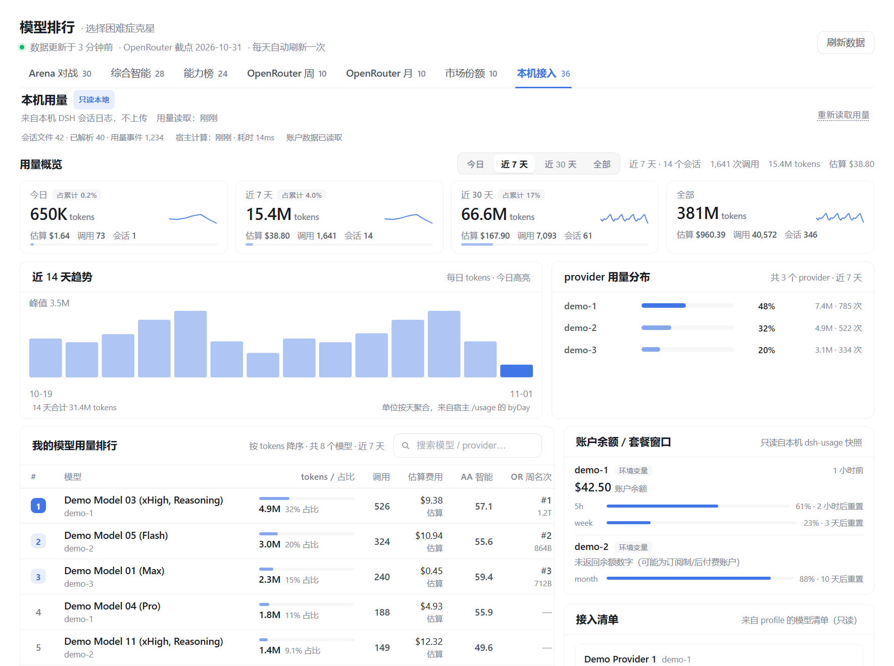
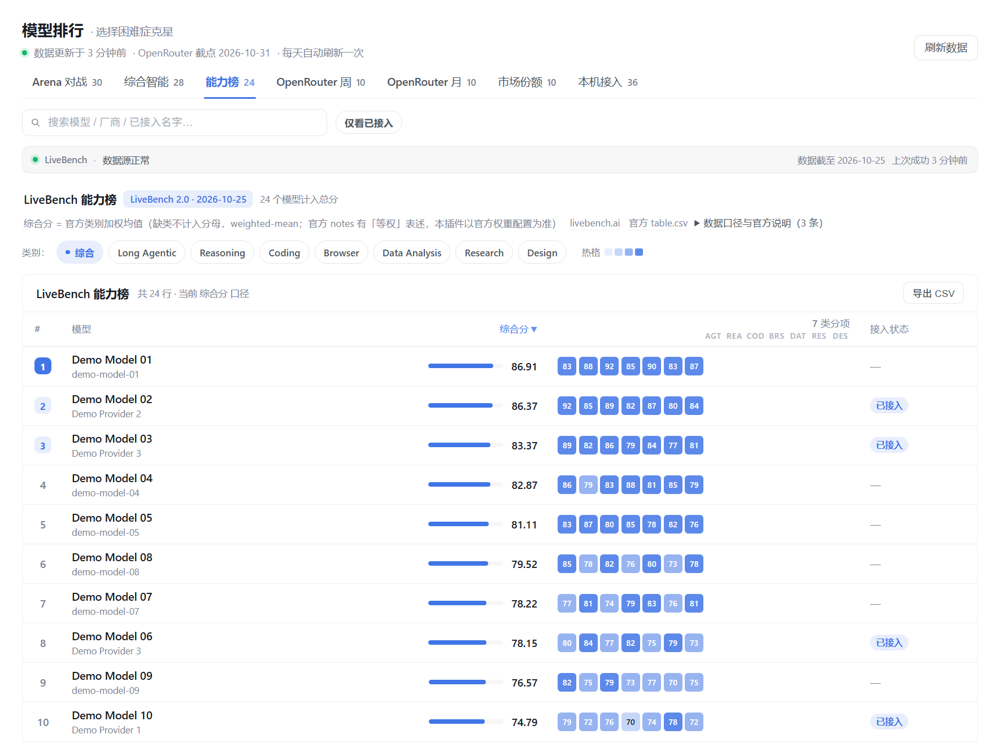
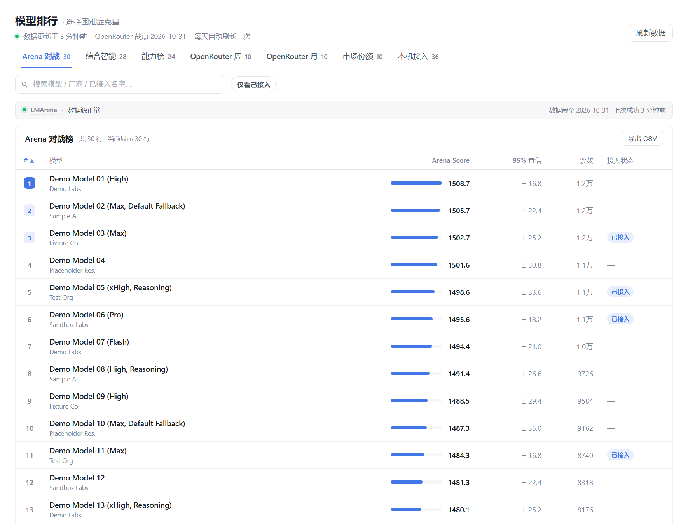

<p align="center">
  <a href="README.en.md">English</a> · <strong>简体中文</strong>
</p>

<p align="center">
  
</p>

<h1 align="center">dsh-model-rank · 模型排行</h1>

<p align="center">
  <strong>你接了一堆模型，到底该用哪个？侧栏开一眼就知道。</strong><br>
  这是一个给 <strong>DeepSeek Harness（DSH）</strong> 用的侧栏插件：装上之后，你的 DSH 左侧栏会多一个
  「模型排行」入口——点开就能对比主流大模型的人类盲测评分、综合智能指数、任务级能力、真实用量与价格速度，
  同时看到你自己接入了哪些模型、实际用了多少。渠道太多、模型太多、每次选模型都要开好几个网页对比？
  这个插件就是为这个场景做的（DSH 桌面版和 <code>dsh web</code> 都能用）。
</p>

<p align="center">
  <a href="https://github.com/Jingxuan-WH/dsh-model-rank/releases/latest"></a>
  <a href="https://github.com/Jingxuan-WH/dsh-model-rank/actions/workflows/ci.yml"></a>
  
  <a href="https://github.com/Jingxuan-WH/dsh-model-rank/stargazers"></a>
  <a href="https://github.com/Jingxuan-WH/dsh-model-rank/commits/main"></a>
  <a href="LICENSE"></a>
</p>

## 30 秒了解

- **一个面板，七个标签页**：Arena 对战、综合智能、能力榜（LiveBench 2.0）、OpenRouter 周用量、
  OpenRouter 月用量、市场份额、本机接入——六张公开榜单 + 一页你自己的用量
  （本机接入页内的「本机用量」仪表盘）。不同口径分开展示，不混在一起算「总分」。
- **自动标出你已接入的模型**：读取本机 `cordis.patch.yml` 的模型清单（只读），
  在每张榜单上打「已接入」标记，不用自己对着型号列表找。
- **打开即显示，不等网络**：宿主每天抓取公开榜单并落盘，面板先读浏览器缓存立即渲染；
  浏览器端不发起任何外部请求。
- **能对比，也能深看**：点击模型行打开明细抽屉；每个榜单可排序、可导出当前筛选结果为 CSV。
- 零配置、不需要任何 API key。

**如果你也这样**，这个插件就是给你写的：接了多家渠道 / 中转 / 官方源，模型列表几十个，
每次选模型都要翻网页对比；或者想知道「榜单第一」和「我真正在用的」差多少、自己的 token 都花在了哪。

## 截图

<p align="center">
  
  <br>
  <sub><b>能力榜（LiveBench 2.0）</b>：长任务 / Agent 能力，官方加权综合分 + 7 类分项；点行看明细、可导出 CSV</sub>
</p>

<p align="center">
  
  <br>
  <sub><b>榜单页</b>：Arena 人类盲测评分 + 已接入标记；支持搜索、仅看已接入、行内明细与 CSV 导出</sub>
</p>

## 功能一览

### 1）六张公开榜单：同一个模型，六个维度

| 标签页 | 你看的是什么 | 数据来源 | 更新 |
|---|---|---|---|
| **Arena 对战** | LMArena 文本榜的人类盲测 Bradley-Terry 评分、置信区间、票数 | LMArena 官方 Hugging Face 数据集 | 随官方发布 |
| **综合智能** | Artificial Analysis 智能指数（0–100）+ 价格 / 速度 / 上下文 / 是否开源 | artificialanalysis.ai（**仅本机运行时抓取**） | 每日 |
| **能力榜** | LiveBench 2.0 长任务 / Agent 能力榜：官方**加权综合分** + 分项（Long Agentic / Reasoning / Coding / Browser / Data Analysis / Research / Design；当前版本 7 类，随官方 release 变化） | livebench.ai 官方公开 CSV（**仅本机运行时抓取**） | 随官方 release；插件每 24 小时检查一次 |
| **OpenRouter 周** | 近一周真实开发者 token 用量（谁在被真正使用） | openrouter.ai/rankings 页面表格 | 每日 |
| **OpenRouter 月** | 近 30 天真实 token 用量 | 同上 | 每日 |
| **市场份额** | 各厂商的请求份额（周） | 同上 | 每日 |

> 这些榜单**互不可比**：人类偏好评分 ≠ 综合能力指数 ≠ 任务级能力基准 ≠ 真实 token 用量。
> 面板会在每个标签页标注口径与来源，不把它们合成一个假「总分」。
>
> 「综合智能」与「能力榜」的数据都**只在本机运行时抓取**，不随安装包内置；
> 首次装好时这两页可能为空，等宿主第一次联网刷新成功后自动出现。

### 2）本机接入：你接入了什么 + 用了多少

- **已接入标记**（所有榜单）：从 `<DSH_HOME>/profiles/*/cordis.patch.yml` 读取模型清单，
  名称归一化后匹配榜单行；「仅看已接入」一键筛出你真正能用的模型。
- **本机用量仪表盘**：
  - **KPI 卡片**：今日 / 近 7 天 / 近 30 天 / 累计的 tokens、**估算**花费与调用次数；
  - **范围切换**：今日 / 近 7 天 / 近 30 天 / 全部一键切换（只切本地已取回的数据）；
  - **我的模型用量排行**：按 tokens 排序，附占比条、AA 智能指数与 OpenRouter 周榜位次（能匹配到时）；
  - **厂商分布 + 近 14 天 token 趋势**；
  - **provider 接入卡片**：每个渠道一张，列出模型与它们在各榜的位置；
  - **账户余额 / 套餐窗口**：本机若有 `dsh-usage` 的账户快照则展示（只读、可选，无则不显示）。
- **口径**：统计覆盖宿主**能读到的全部会话日志**——包括早于插件安装的历史会话（旧日志被清理后对应数字会减少）；
  按 **Asia/Shanghai 自然日** 分桶（今日 / 近 7 天 / 近 30 天均含今天、以该时区计算）。
- **费用**：按 **Artificial Analysis 公开美元价**（USD / 1M tokens）× 本机 token 用量**估算**，
  面板显示**定价覆盖度**（已定价 tokens 占比）；部分网关私有模型没有公开价，对应费用显示「—」，不用 0 冒充；
  估算不等于你的账单，且首次运行时抓取成功前不显示费用估算。
- 数据来自本机会话日志的只读聚合，**不上传、不联网**。

### 3）通用交互：排序 / 明细抽屉 / CSV 导出 / 来源状态条

- **表头排序**：各榜单点表头按当前列排序（升/降序）。
- **模型明细抽屉**：点击 **Arena / 综合智能 / 能力榜** 中的模型行，从侧边打开明细：
  榜单分项、价格速度、能力分项与你的本机用量（有则显示）。
- **CSV 导出**：把当前榜单**当前筛选后**的结果导出为 CSV（本地浏览器生成，带 UTF-8 BOM，
  Excel 打开中文不乱码；不经过任何服务器）。
- **来源状态条**：每个榜单头部显示该数据源的状态——来源、榜单版本 / 同步时间，
  以及数据源异常时的 stale 提示。

### 4）打开即用：快照与缓存

- 宿主启动后检查是否到期：成功抓取后 **24 小时**内不重抓，失败 **2 小时**后重试；
  面板右上角「刷新数据」有 10 分钟最小间隔。
- 初始加载先渲染浏览器本地缓存 → 再与宿主快照对齐，所以打开面板不等网络。
- 抓取失败时保留上一份快照并标记「数据源待更新」，不伪造、不清零。

### 5）视觉改版（v0.2.0）

更克制的排行视觉、粘性表头、窄屏表格转卡片、跟随 DSH 明暗主题；明细抽屉随视觉重构一起上线。

## 安装

**要求**：

- **DSH 0.2.x**（在 **0.2.1-rc.5** 上实测）。
- 宿主运行时需要 **Node.js ≥ 22.15**（`node:zlib` 的 zstd 解码能力，用于读取压缩的会话日志；
  更低版本只会跳过 `.zstd` 压缩日志并给出 warning，未压缩日志不受影响）。DSH 自带运行时通常已满足。

插件无构建步骤，装完重启一次 DSH 即可。

### 桌面端（推荐，约 30 秒）

1. 打开 DSH 桌面应用 → **设置 → 插件**；
2. 选择**添加插件**，在「包名或地址」中粘贴：

   ```
   https://github.com/Jingxuan-WH/dsh-model-rank
   ```

3. 按提示重启 DSH（宿主端插件在启动时组合，重启最稳妥）；
4. 左侧栏出现「模型排行」图标，点开即用。

### Web 端（`dsh web`）

```bash
dsh plugin --profile web add https://github.com/Jingxuan-WH/dsh-model-rank
```

装完重启 `dsh web`，刷新页面即可在左侧栏看到入口。

> 其他 profile 把 `web` 换成你的 profile 名；桌面版的 profile 由应用托管，请用应用内插件页安装。

### 装好后的 30 秒验证

1. **看左侧栏**：重启 DSH 后，左侧栏出现「模型排行」图标；
2. **点开它**：面板顶部能看到「数据更新于 …」与七个标签页（Arena 对战 / 综合智能 / 能力榜 /
   OpenRouter 周 / OpenRouter 月 / 市场份额 / 本机接入）；
3. **点「本机接入」标签**：能看到本机用量仪表盘（KPI 卡片、用量排行）与接入清单（刚装好还没抓到数据时，
   会显示「内置快照」并说明从何时开始统计；「综合智能」「能力榜」等宿主首次联网刷新后出现）。

三条都对上，就说明安装成功、宿主与面板都通了。

### 升级 / 卸载

- **升级**：重新执行安装命令（会拉取最新版本），然后重启 DSH。桌面端在插件页里更新。
- **卸载**：插件页移除，或：

  ```bash
  dsh plugin --profile web remove dsh-model-rank
  ```

  卸载不会删除你的本地缓存数据（见「隐私」一节），确认不需要后可手动删除对应目录。

## 常见问题

**Q：装完没看到侧栏入口？**
先重启一次 DSH 再刷新页面。桌面端的 profile 由应用托管，用插件页安装最稳；Web 端确认装到了当前 profile。

**Q：为什么「综合智能」和「能力榜」第一次打开是空的？**
这两份数据都只在你本机运行时抓取，不随安装包内置（合规原因）。
宿主首次联网刷新成功后它们会自动出现；其他榜单会立刻显示（来自内置兜底快照或本地缓存）。

**Q：数据多久更新一次？为什么我点「刷新数据」没变化？**
宿主成功抓取后 24 小时内不重抓，失败 2 小时后重试；手动刷新有 10 分钟最小间隔。
每个榜单头部的来源状态条会显示该数据源的版本 / 同步时间；「数据更新于」显示当前快照的数据时间。

**Q：能力榜（LiveBench 2.0）的综合分怎么算？**
按官方公开数据 `categories.json` 里的 `_overall_weights` 做**加权平均**：Long Agentic 2.0、
Coding 1.5、Design 1.5，其余类别 1.0；某个类别没有分数时不参与计算（不进分母）。
当前版本为 7 类，随官方 release 变化。各模型测试时使用**最高 supported effort** 设置。
分数为官方公开数据，本插件只做展示。

> 如实说明一处官方数据自身的矛盾：官方 `notes.json` 有一条写「Overall is the mean of the suites …
> Every suite counts equally」（等权），与 `categories.json` 的权重配置**不一致**。本插件以
> **权重配置**为准，并在面板上标注公式；若官方后续统一口径，插件会随数据更新调整。

**Q：几个排行榜的分数能互相比较吗？**
不能。Arena 是人类盲测偏好评分，综合智能是第三方能力指数，能力榜（LiveBench 2.0）是任务级能力基准，
OpenRouter 是真实 token 用量；它们来自不同的测量体系（面板的 6 个公开榜单视图 / 4 个公开数据源），
口径完全不同，面板刻意不合并成总分、也不跨榜混排。

**Q：本机用量从什么时候开始统计？**
统计覆盖宿主**能读到的全部会话日志**——包括早于插件安装的历史会话；按 Asia/Shanghai 自然日分桶。
旧日志被清理后，对应数字会减少（已删除的数据不会回填）。

**Q：费用准吗？为什么有些模型显示「—」？**
费用是按 Artificial Analysis 公开价格估算的，仅供参考；只有能匹配到公开价格的 token 才计价，
面板会显示「定价覆盖度」；部分网关私有模型没有公开价，费用显示「—」而不是 0。

**Q：CSV 导出的内容是什么？中文会乱码吗？**
导出你**当前标签页、当前搜索/筛选后**的表格结果（含表头），在本地浏览器生成并下载，不经过任何服务器；
文件带 UTF-8 BOM，Excel 直接打开中文不乱码。

**Q：明细抽屉怎么打开？**
在 Arena / 综合智能 / 能力榜里点击任意模型行；抽屉展示该模型的分项数据、价格速度与你的本机用量（若有）。

**Q：为什么我接入的模型没有「已接入」标记？**
匹配基于名称归一化，部分渠道的专有马甲名可能匹配不上（属预期）。欢迎带模型名提 issue。

**Q：它会读取我的聊天记录或上传数据吗？**
不会上传。插件只在你的本机读取配置与用量事件（只读），聚合结果与 CSV 导出都留在本机；
浏览器端不发起外部请求。详见「隐私」。

**Q：需要 API key 吗？会花钱吗？**
不需要。抓取的都是公开榜单页面，没有任何账号或 API key；插件本身不调用模型。

**Q：支持哪些 DSH 版本？**
0.2.x（在 0.2.1-rc.5 上实测）。更老的版本可能缺少对应 slot，不保证可用。

## 数据口径与来源

面板共有 **7 个标签页**：其中 **6 个公开榜单视图**（Arena 对战 / 综合智能 / 能力榜 / OpenRouter 周 /
OpenRouter 月 / 市场份额）来自 **4 个公开数据源**（LMArena / Artificial Analysis / LiveBench / OpenRouter），
另有 **1 个本地视图**（「本机接入」页，数据来自你自己的机器）。加上本地来源，共 **5 个数据来源**——
它们来自**不同的测量体系**，**彼此不可混比**，插件从不把它们合并成一个「总分」。
每个标签页都会标注自己的口径；下表的「来源」就是宿主实际访问的公开页面。

| 视图（面板标签） | 口径（一句话） | 来源 | 更新节奏 | 许可 / 署名 |
|---|---|---|---|---|
| **Arena 对战** | 人类两两盲测的 Bradley-Terry 偏好评分（附置信区间与票数） | LMArena 官方 Hugging Face 数据集 [`lmarena-ai/leaderboard-dataset`](https://huggingface.co/datasets/lmarena-ai/leaderboard-dataset)（经 Hugging Face datasets-server 公开端点读取） | 随 LMArena 官方发布（通常隔日到数日）；插件每 24 小时检查一次 | **CC BY 4.0**（数据集许可） |
| **综合智能** | Artificial Analysis 智能指数（0–100），附价格 / 速度 / 上下文 / 是否开源 | [artificialanalysis.ai/models](https://artificialanalysis.ai/models) | 随 AA 页面更新；插件每 24 小时**在你的本机运行时**抓取一次 | **仅运行时抓取，不随仓库 / 安装包分发**；数据权利归 Artificial Analysis |
| **能力榜**（LiveBench 2.0） | LiveBench 2.0 长任务基准：当前 release 各能力套件的官方**加权均值**（权重取自官方 categories JSON；缺失套件不计入分母；当前版本 7 类，随官方 release 变化），面板显示当前 release 版本号 | [livebench.ai](https://livebench.ai/)（官方公开 CSV：`/data/<release>/table.csv` 与 `categories.json`） | 随 LiveBench 官方 release；插件每 24 小时检查一次 | **仅运行时抓取，不随仓库 / 安装包分发**；LiveBench 是独立开源项目（代码 Apache-2.0），数据权利归 LiveBench |
| **OpenRouter 周 / 月 / 市场份额** | OpenRouter 页面公开表格：近 7 天 / 近 30 天真实 token 用量，以及各厂商请求份额 | [openrouter.ai/rankings](https://openrouter.ai/rankings) | 随页面更新（页面标注「数据截止日」）；插件每 24 小时抓取一次 | **CC BY 4.0**（以来源站点说明为准） |
| **本机接入** | 你本机的 token 用量、估算花费与接入清单（只读聚合，不上传） | 你自己的机器：`<DSH_HOME>/profiles/*/cordis.patch.yml`、`<DSH_HOME>/sessions/**/session*.jsonl(.zstd)`，以及可选的 `<DSH_HOME>/dsh-usage/provider-snapshots.json` | 每次刷新读取；面板可见时每 60 秒静默刷新（只切本地数据） | 你的数据；只读、不上传 |

> 「数据更新于」是快照的抓取时间；各来源自身的「数据截止时间」以来源页面为准，抓取节奏 ≠ 数据新鲜度。

**为什么不可比（请勿换算 / 混排）**

- 这些数字**没有任何换算关系**：Arena 的 1500 分、AA 的 42、LiveBench 的 85.7、OpenRouter 的 1.2T tokens
  单位、样本与测量目的都不同（示意，非具体模型）。
- 面板**不计算总分、不跨榜排序、不做加权合并**；各标签页独立展示。
- 同一来源的不同窗口（OpenRouter 周 / 月 / 份额）也互相独立，不能相加。
- 能力榜只展示 **LiveBench 当前 release**；不同 release 的模型集与分数不混排。
- 「估算花费」是估算，不是账单（见下方「本机用量口径」）。

**分发与关联声明**

- 随仓库 / 安装包分发的内置兜底快照**只包含 LMArena 与 OpenRouter 数据**；Artificial Analysis 与 LiveBench
  数据只在你本机运行时抓取并缓存在本机，**不再随仓库或安装包分发**（0.1.0 的内置快照曾包含 AA 数据，
  0.2.0 起移除——见 CHANGELOG）。
- 能力榜需要宿主**首次联网刷新成功后才出现**（内置快照里没有它）；离线时保留上次成功的数据并标记 stale。
- 本项目与 LMArena、Artificial Analysis、LiveBench、OpenRouter **均无关联**；数据权利归各自来源，
  以来源页面说明为准；本插件只做聚合与展示。
- 代码许可见 [LICENSE](LICENSE)（MIT）——**代码许可与数据许可是两件事**。

**本机用量口径**

- **读什么**：只读上表所列的本机路径（DSH 配置 + 会话日志）；不读聊天正文，不上传，浏览器端不发起任何外部请求。详见「隐私」一节。
- **token 口径**：未缓存输入、缓存读、缓存写、输出四类分开统计，`总 tokens = 四者之和`；同一轮次（turn/step）的
  临时用量事件与最终用量事件只算一次（以最终事件为准）；调用次数 = 去重后的用量事件数。
- **费用（估算）**：按 **Artificial Analysis 公开美元价**（USD / 1M tokens）× 本机 token 用量估算，界面标注「估算」，
  **不是账单**；只对能匹配到公开价格的模型计价，未定价模型显示 `—`（不显示 0）；面板会显示**定价覆盖度**
  （已定价 tokens 占总 tokens 的比例）。内置快照不含 AA 数据，因此**首次运行时抓取成功前不显示费用估算**。
- **时区与分桶**：按 **Asia/Shanghai（UTC+8）自然日**分桶；「今日」= 本机时区的今天自然日；
  「近 7 天 / 近 30 天」均含今天。
- **统计起点**：统计覆盖宿主**能读到的全部会话日志**——包括早于插件安装的历史会话；旧日志被清理后，
  对应数字可能减少（不会回填已删除的数据）。
- **读取失败时**：跳过该文件并给出提示，不阻塞其它数据；不伪造、不清零。

## 隐私

这个插件会读你本机的文件，所以把边界写清楚：

| 读什么 | 用途 | 方式 |
|---|---|---|
| `<DSH_HOME>/profiles/*/cordis.patch.yml` | 得到本机已接入的 provider / 模型清单，用于「已接入」标记 | 只读 |
| `<DSH_HOME>/sessions/**/session*.jsonl(.zstd)` | 解析 usage 事件，聚合本机用量 | 只读 |
| `<DSH_HOME>/dsh-usage/provider-snapshots.json`（若存在） | 展示渠道余额 / 套餐窗口（可选） | 只读 |

- **不上传**：没有遥测、没有登录、没有服务端；聚合结果与 CSV 导出都只留在本机。
- **网络**：只有宿主半侧会访问公开榜单页面（见上表来源）；**浏览器端不发起任何外部请求**。
- **缓存位置**：`<DSH_HOME>/dsh-model-rank/`（默认 `~/.dsh/dsh-model-rank/`）。
  可用环境变量 `DSH_MODEL_RANK_DATA_DIR` 改到别处。
- **卸载后**：缓存与用量索引文件**保留在本机**（方便你重装后继续看历史），可手动删除
  `<DSH_HOME>/dsh-model-rank/` 目录；里面只有聚合数字，不含会话原文、账号或 API key。
- README 与本仓库截图使用示例数据（`demo-*`），不含任何真实 provider / 余额 / 会话内容。

## 工作原理

```text
DSH 宿主（Node，本机）
  ├─ 每天抓取公开榜单（LMArena / OpenRouter / AA·运行时 / LiveBench·运行时）
  │    → 归一化 → 快照落盘 <DSH_HOME>/dsh-model-rank/snapshot.json
  ├─ 只读扫描本机会话日志 → 用量聚合（磁盘增量缓存）
  └─ 本地 RPC：GET /_dsh/dsh-model-rank/{snapshot,status,usage} · POST .../refresh
        ▲ 仅本机回环 + 已认证连接
浏览器端（DSH 面板）
  └─ 左侧栏「模型排行」：先读 localStorage 缓存立即渲染 → 再与宿主 RPC 对齐
```

## 数据、缓存与本地 API

- **缓存目录**：`<DSH_HOME>/dsh-model-rank/`（默认 `~/.dsh/dsh-model-rank/`，可用 `DSH_MODEL_RANK_DATA_DIR` 覆盖），
  主要文件：`snapshot.json`（榜单快照）、`usage-cache.json`（本机用量增量缓存）。
- **环境变量**（均带默认值）：`DSH_MODEL_RANK_REFRESH_MS`（成功后冷却，默认 24h）、
  `DSH_MODEL_RANK_RETRY_MS`（失败重试，默认 2h）、`DSH_MODEL_RANK_MIN_GAP_MS`（手动刷新最小间隔，默认 10min）、
  `DSH_MODEL_RANK_DATA_DIR`（缓存目录）。
- **本地 RPC**（仅本机回环 + 已认证连接；浏览器的面板只用这些接口，不直接访问外网）：

  | 接口 | 用途 |
  |---|---|
  | `GET  /_dsh/dsh-model-rank/snapshot` | 快照 + 元信息 |
  | `GET  /_dsh/dsh-model-rank/status` | 刷新节奏、来源成败、用量摘要 |
  | `GET  /_dsh/dsh-model-rank/usage` | 本机用量聚合（只读） |
  | `POST /_dsh/dsh-model-rank/refresh` | 触发刷新；body `{"force":true}` 可越过 10 分钟手动节流，**但 force 每小时最多 3 次**（超出返回 `force-limited` 与重试时间，客户端只在「强制刷新」时使用） |

- 刷新失败时保留上一份快照并标记「数据源待更新」；不会清零或伪造数据。

## 已知边界

- Artificial Analysis / LiveBench 只在运行时抓取：首次装好、或数据源暂时不可用时对应页面为空或显示旧数据（stale）。
- LiveBench 每个 release 的模型数会波动（例如 2026-10-25 版 32 个）；界面显示的是该版本实际行数。
- LiveBench 站点结构变化时，解析器会保留旧数据并标记 stale，不会伪造或清零。
- 能力榜只展示 LiveBench 2.0（当前代际），不与 v1 旧版数据混排。
- 渠道专有命名的模型可能匹配不上公开榜单，属预期（名称归一化已处理常见后缀）。
- 旧 Node 运行时（< 22.15）缺少 zstd 解码能力，压缩的会话日志会被跳过并给出 warning，未压缩日志不受影响。
- 估算费用只覆盖能匹配到公开价格的模型；私有网关价格不公开时显示「—」。

## 路线图

- **v0.2.0（本轮）**：能力榜（LiveBench 2.0）、本机用量仪表盘、明细抽屉、CSV 导出、来源状态条、视觉改版、
  内置快照隐私净化。
- **规划中（未实现，不承诺时间）**：LiveBench 历史版本对比（v1/v2 不混排）、用量趋势更多图表、
  能力 vs 成本的性价比视图、更多历史对比视图。
- 想优先做哪个？欢迎到 [Issues](https://github.com/Jingxuan-WH/dsh-model-rank/issues) 说场景。

## 开发与验证

```text
dsh-model-rank/
├── lib/
│   ├── index.js      # 宿主半侧：路由注册、每日快照调度、落盘
│   ├── pipeline.js   # 纯数据管线：抓取 / 解析 / 名称归一化 / 快照合并
│   ├── livebench.js  # LiveBench 2.0 能力榜：版本发现 / CSV 抓取 / 加权综合分解析
│   ├── usage.js      # 本机用量聚合（只读会话日志 + 增量缓存）
│   └── client.js     # 客户端 bundle：侧栏入口 + 面板 UI（单文件、无构建）
├── data/snapshot.json# 随包分发的内置兜底快照（只含 LMArena + OpenRouter）
├── scripts/
│   ├── build-snapshot.mjs      # 重新生成内置快照（会联网）
│   ├── validate-host.mjs       # 宿主桩集成验证（不联网）
│   ├── validate-parsers.mjs    # 解析器 / 匹配器离线回归（fixture）
│   ├── validate-usage.mjs      # 本机用量聚合验证（假数据，不碰真实会话）
│   ├── validate-livebench.mjs  # 能力榜解析验证（离线 fixture）
│   └── validate-client.mjs     # 无头 React 渲染回归
└── .github/workflows/ci.yml    # 轻量 CI：语法 + manifest / 内置快照隐私自检（不联网、不装依赖）
```

```bash
npm install            # 唯一运行时依赖：yaml（验证脚本 import lib 时会用到）

node --check lib/index.js
node --check lib/pipeline.js
node --check lib/livebench.js
node --check lib/usage.js
node --check lib/client.js
node --check scripts/build-snapshot.mjs
node --check scripts/validate-host.mjs
node --check scripts/validate-parsers.mjs
node --check scripts/validate-livebench.mjs
node --check scripts/validate-usage.mjs
node --check scripts/validate-client.mjs

node scripts/validate-host.mjs        # 宿主桩集成（不联网）
node scripts/validate-parsers.mjs     # 解析器 / 匹配器离线回归
node scripts/validate-livebench.mjs   # 能力榜解析（离线 fixture）
node scripts/validate-usage.mjs       # 本机用量聚合（假数据，不碰真实会话）
# 客户端回归（临时安装 React，不进 package.json）
npm install --no-save --no-audit --no-fund react@18.3.1 react-dom@18.3.1
node scripts/validate-client.mjs
```

所有验证脚本默认不联网；`validate-parsers` / `validate-usage` / `validate-livebench` 使用假数据与离线 fixture，不读取真实会话。

贡献前请先读 [CONTRIBUTING.md](CONTRIBUTING.md)；隐私红线与代码约定都在里面。

## 贡献与反馈

- Bug / 功能建议：用 Issue 模板；
- 使用问题：Discussions；
- PR 请保持一个 PR 一件事，并附验证结果（UI 改动附 demo 数据截图）。

## 如果它帮到了你

给模型选型省下的时间如果值一个 Star，就点一下 ⭐ —— 这是这类小工具继续维护下去最直接的动力。

## License

代码 [MIT](LICENSE)。榜单数据版权归各自来源，见「数据口径与来源」。
